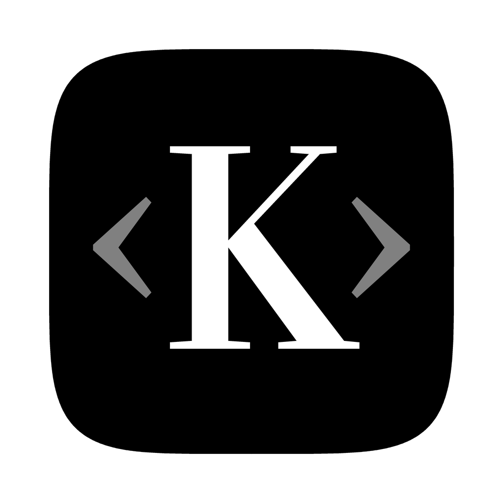
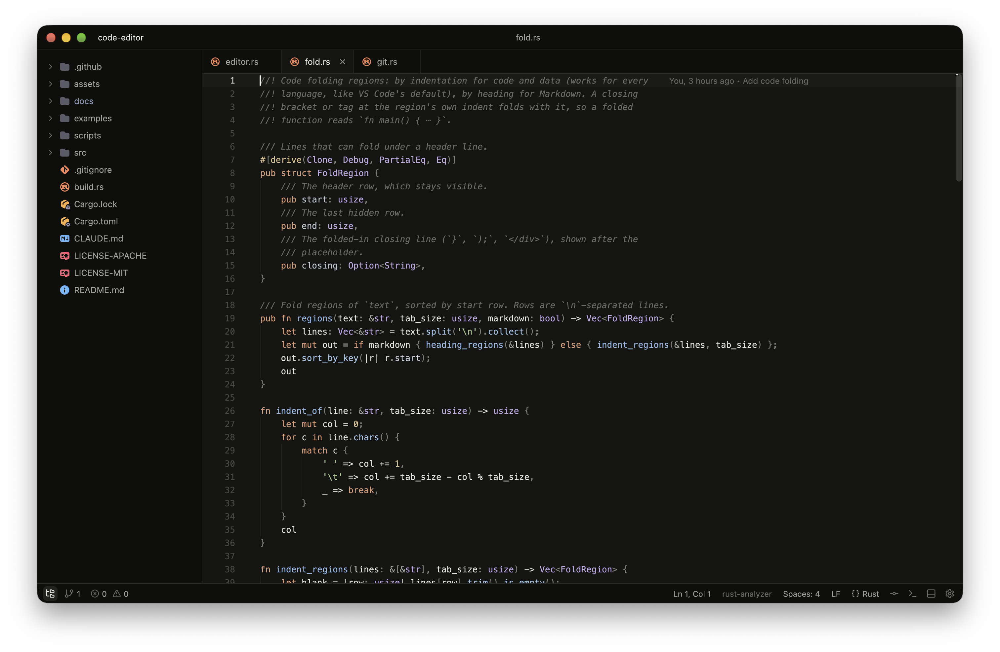

<p align="center">
  
</p>

# Kin

A small, fast code editor written in Rust, rendered entirely on the GPU with
[GPUI](https://www.gpui.rs) (Metal on macOS, DirectX on Windows), with
platform-native text rendering (CoreText / DirectWrite).

<p align="center">
  
</p>

## Features

- Rope-backed buffer (`ropey`) with undo/redo; only visible lines are shaped and painted
- Tree-sitter syntax highlighting for JavaScript/JSX, TypeScript/TSX, HTML (including `<script>` blocks),
  CSS, Rust, Go, Python, PHP, shell scripts, JSON, YAML, TOML and Markdown; any other language
  through [extensions](#extensions), which use Zed's format (Zed's language and theme extensions work)
- Linting off the main thread:
  - **JavaScript** — syntax errors plus `no-unused-vars`, `no-undef`, `no-const-assign`,
    `no-dupe-keys`, `eqeqeq`, `use-isnan`, `no-cond-assign`, `no-debugger`, `no-var` (built on oxc)
  - **TypeScript** — the same rules except `no-undef` (TypeScript checks names itself); type-only
    uses count as uses; `.d.ts` files get syntax errors only
  - **HTML** — unclosed/stray/void closing tags, duplicate attributes and ids, `img` alt,
    `lang`, doctype, `<title>`, obsolete tags, `target="_blank"` without `rel`; inline scripts are linted as JS
  - **Markdown** — the markdownlint rules (MD001–MD07x: heading structure, list style, code
    fence languages, trailing spaces, duplicate headings, broken reference and relative links…)
    via [rumdl](https://rumdl.dev). A project's `.markdownlint.json`/`.yaml`, `.rumdl.toml` or
    `pyproject.toml` `[tool.rumdl]` is used when present; otherwise line length (MD013) is off
  - **ESLint** — if the file's project has `node_modules/.bin/eslint`, it runs on open/save with the
    project's own config (JavaScript and TypeScript); built-in rules then drop back to syntax errors only
  - **CSS, Rust, Go, Python, PHP, shell, JSON, YAML, TOML** — syntax errors from the tree-sitter parser
    (unexpected and missing tokens)
- Language servers (LSP) for code intelligence: diagnostics, completion, hover documentation,
  signature help, Go to Declaration / Implementation / Type Definition, Find Usages, highlighted
  uses of the symbol at the caret, Go to Symbol across the project, Rename and context actions
  (quick fixes and refactorings); see [Language servers](#language-servers)
- Inlay hints from the language server (types, parameter names), rulers, visible whitespace,
  column (box) selection with Alt+drag, sort/reverse/de-duplicate lines and case conversions
  (upper, lower, title, snake, kebab, camel, Pascal) from Find Action
- Vim mode (`vim_mode`): Normal, Insert, Visual and Visual Line; see [Vim mode](#vim-mode)
- Reformat Code (⌥⌘L / Ctrl+Alt+L) and optional format on save, with the project's formatter
  (e.g. its Prettier), the language server, or rustfmt/gofmt/ruff/black/taplo/shfmt on PATH
- Inline diagnostics, gutter markers, scrollbar markers and a Problems panel
- Multi-cursor (next/all occurrences, ⌥-click, add caret above/below), syntax-aware Extend Selection,
  auto-closing pairs, smart indent, line/block comments, move/duplicate/join/delete lines
- Matching-bracket highlight (ignores brackets in strings and comments) and an editor right-click menu
- Soft wrap that keeps indentation, on by default for Markdown and plain text (View → Soft-Wrap
  toggles it per file)
- Markdown preview: the button at the top right of a Markdown file (or **Toggle Markdown Preview**,
  ⌘K V / Ctrl+K V in the VS Code and Zed keymaps) shows the rendered document beside the text,
  updated as you type: headings, emphasis, lists and task lists, quotes, tables, highlighted code
  blocks, local images; links open in the browser. Zoom it with the − / + control at its top right
  (click the percentage to reset) or ⌘/Ctrl + scroll
- Find/Replace bar with case, whole-word and regex options; Find/Replace in Files with preview
  (searches unsaved buffers too, honors .gitignore)
- Search Everywhere (double Shift), fuzzy Go to File (git-ignored files included, ignored folders
  skipped), Recent Files, Find Action, Go to Line, and File Structure: the current file's functions,
  classes, headings, selectors or keys
- Breadcrumbs under the tabs (folders, file, then the definitions around the caret; click one to go
  there) and sticky scroll: the header lines of the functions and classes you've scrolled into stay
  pinned at the top of the editor (up to four; click one to jump to it)
- Git: clone, init, gutter change markers with rollback, inline blame, file status colors, a Commit panel
  (stage, discard, commit, amend, push), staging single changes, side-by-side diffs with changed words
  highlighted, a log with a branch graph and file history, merge/rebase with conflict resolution in
  the editor, branches, pull and fetch
- Welcome screen with quick-start tiles, Recent Projects, a Git card for the open repository and quick actions
- 31 built-in themes (24 dark, 7 light) and JSON user themes with live preview
- Multiple windows, one project each (like Zed), with a Recent Projects picker; on macOS the
  Window menu and the Dock icon's menu list them
- Integrated terminal (⌥F12 / Alt+F12): your login shell in tabs, full colors, mouse support for
  full-screen programs, selection and copy/paste, Find in the output and scrollback; shell keys
  like Ctrl+R reach the shell; split groups, renamable tabs, and each project's terminals come back
  in their folders
- Code folding by indentation (Markdown by section), with gutter arrows and a `⋯` placeholder;
  folds are kept with the project
- Split panes (side by side or stacked, a file in both if you like) with draggable dividers; drag tabs to reorder them or
  move them between panes; pinned tabs; a tab menu with Close Others / All / to the Right
- Debugger for Rust, Go, Python and JavaScript/TypeScript (lldb-dap, Delve, debugpy, js-debug):
  breakpoints with conditions and logpoints, attaching to running processes, stepping, frames,
  variables, watches and an evaluating console; see [Debugging](#debugging)
- Restricted Mode for folders you haven't trusted (like VS Code and Zed): no language servers,
  formatters or project tools until you do; see [Project trust](#project-trust)
- Python virtual environments detected per project and used by terminals, Run, the debugger,
  language servers and formatters; see [Python environments](#python-environments)
- Run and test: ▶ in the gutter next to tests and `main` functions (Rust, Go, Python, JS/TS),
  project commands (cargo, npm scripts, go, make, pytest) and your own run configurations, each
  in its own terminal tab with a pass/fail icon; see [Run and test](#run-and-test)
- Image preview: PNG, JPEG, GIF (animated), WebP, BMP, TIFF, ICO, TGA and QOI files open as a
  picture with their dimensions and size (SVG stays text); Git diffs show an image's before and after
- Encodings and line endings: files keep their encoding (UTF-8 with or without BOM, UTF-16,
  Windows-125x, ISO-8859-2, Shift JIS, EUC-KR, GBK, Big5) and line endings when saved; the status
  bar shows both, and clicking them reloads the file in another encoding or converts it (as in
  JetBrains). Files that aren't UTF-8 are read as Windows-1252, so no byte is lost. Text an
  encoding can't hold is never saved in it. Files over 20 MB open as plain text without language
  features; over 500 MB they don't open
- Live file watching: the file tree, Go to File, Git status and branch, the Git log and open files
  follow changes made outside Kin (a checkout, a generator, another editor) as they happen
- File tree with new file/folder, rename, duplicate, copy/paste, Move to Trash, Find in Folder and
  Reveal in Finder; drag entries onto a folder to move them (open tabs follow); **Select Opened File**
  (⌥F1 / Alt+F1, or a tab's menu) shows the current file in the tree; ⌘Z / ⇧⌘Z (Ctrl+Z / Ctrl+Shift+Z)
  in the tree, or its right-click menu, undo and redo file operations, deletes included (they come
  back from the Trash); tabs, custom title bar, IME support
- A Settings dialog for every option, with search across its pages; see [Settings](#settings)
- Automatic updates from GitHub Releases (signed), installed with **Restart to Update**; see
  [Releases and updates](#releases-and-updates)

## Running

```bash
cargo run --release -- path/to/folder path/to/file.js
```

Each folder on the command line opens in its own window; files open in the first one.

GPUI's `runtime_shaders` feature is enabled, so no separate Metal toolchain is needed on macOS.
Building needs `cmake` (for wasmtime, which runs extensions' WebAssembly grammars):
`brew install cmake` on macOS.

### App icon

The icon (a purple serif K with a pastel painted peacock) lives in [`assets/app-icon/`](assets/app-icon):

- **macOS:** the Dock icon is set at startup, so it shows even with `cargo run`. To build a
  `Kin.app` that uses `macos/Kin.icns`, run `cargo install cargo-bundle` and then
  `cargo bundle --release`.
- **Windows:** `build.rs` embeds `windows/kin.ico` into the executable, so it shows in
  Explorer, the title bar and the taskbar.
- **Linux:** the window's app id is `dev.kin.editor`. Copy `linux/hicolor/` into
  `~/.local/share/icons/hicolor/` and `linux/dev.kin.editor.desktop` into
  `~/.local/share/applications/`.

## Releases and updates

Pushing a version tag builds and publishes a GitHub Release
([`.github/workflows/release.yml`](.github/workflows/release.yml)):

```bash
# bump `version` in Cargo.toml first; the tag must match it
git tag v0.2.0
git push origin v0.2.0
```

The release gets a universal macOS `Kin.app` (`.dmg` and `.zip`), a Windows installer
(`-setup.exe`, per user, no admin rights; made with Inno Setup from
[`scripts/kin.iss`](scripts/kin.iss)) and `.zip`, and a Linux `.tar.gz`, plus `latest.json`, which the workflow signs with
[minisign](https://jedisct1.github.io/minisign/) using the `MINISIGN_SECRET_KEY` repository
secret. Tags with a hyphen (`v0.3.0-beta.1`) become pre-releases, which the updater skips.
The release notes come from [git-cliff](https://git-cliff.org) ([`cliff.toml`](cliff.toml)):
every commit and pull request since the previous tag, each change once (a pull request is one
line, however it was merged), with authors @mentioned and first-time contributors listed.

Released builds check for updates shortly after launch and every few hours (unless
`auto_update` is `false`; **Check for Updates…** works either way), download in the background
and show **Restart to Update** in the status bar. They only install an update whose
`latest.json` carries a valid signature from the key in `src/updater.rs`. Builds from source
don't update themselves. **About Kin** (first in the app menu, and in Find Action) shows the
version and the commit it was built from; **Copy Version** copies both for bug reports.

Until the macOS app is signed with a Developer ID (below), it's only ad-hoc signed, so macOS
blocks the first launch of a downloaded copy: allow it under System Settings → Privacy &
Security → **Open Anyway**, or run `xattr -dr com.apple.quarantine /Applications/Kin.app`.
Updates don't need this.

### Signing the macOS app

The workflow signs `Kin.app` and the `.dmg` with a Developer ID and has Apple notarize them as
soon as these repository secrets exist (Settings → Secrets and variables → Actions). It needs
an [Apple Developer Program](https://developer.apple.com/programs/) membership.

1. **Certificate:** in Xcode → Settings → Accounts → Manage Certificates, add a **Developer ID
   Application** certificate. In Keychain Access → My Certificates, export it (with its private
   key) as a `.p12` with a password.
   - `MACOS_CERTIFICATE`: the file as base64, `base64 -i Certificates.p12 | pbcopy`
   - `MACOS_CERTIFICATE_PASSWORD`: the export password
2. **Notarization key:** in [App Store Connect](https://appstoreconnect.apple.com) → Users and
   Access → Integrations → App Store Connect API, generate a team key with the Developer role and
   download `AuthKey_….p8` (possible only once).
   - `APPLE_API_KEY`: the `.p8` file's text, `pbcopy < AuthKey_….p8`
   - `APPLE_API_KEY_ID`: the key's ID
   - `APPLE_API_ISSUER`: the Issuer ID shown above the keys

With only the certificate, releases are signed but not notarized, which macOS still blocks.
Notarizing adds a few minutes per release; a rejection fails the macOS build with Apple's log
([`scripts/notarize.sh`](scripts/notarize.sh)).

## Key bindings

Kin starts from the JetBrains IDE keymaps: the macOS keymap on macOS and the
Windows/Linux keymap elsewhere. On macOS the Ctrl variants of Find/Replace
(Ctrl+F, Ctrl+R, Ctrl+Shift+F, Ctrl+Shift+R) work too. Every action is also
reachable through Find Action, which shows its shortcut.

To use other shortcuts, pick a **Base keymap** in Settings → Keymap (or set `"base_keymap"` in
`settings.json`): **JetBrains** (the default), **VS Code**, **Sublime Text** or **Zed**, each in its
macOS or Windows/Linux variant, like Zed's setting of the same name. Shortcuts you change yourself
(`keymap.json`) stay on top of whichever you pick, and menus and Find Action show the current keys.
The table below is the JetBrains keymap.

| Action | macOS | Windows / Linux |
| --- | --- | --- |
| Search Everywhere | Double ⇧ | Double Shift |
| Go to File | ⌘⇧O | Ctrl+Shift+N |
| Recent Files | ⌘E | Ctrl+E |
| Find Action | ⌘⇧A | Ctrl+Shift+A |
| Go to Line:Column | ⌘L | Ctrl+G |
| File Structure | ⌘F12 | Ctrl+F12 |
| Find / Replace | ⌘F / ⌘R | Ctrl+F / Ctrl+R |
| Next / previous occurrence | ⌘G / ⌘⇧G, F3 / ⇧F3 | F3 / Shift+F3 |
| Find / Replace in Files | ⌘⇧F / ⌘⇧R | Ctrl+Shift+F / Ctrl+Shift+R |
| Extend / shrink selection | ⌥↑ / ⌥↓ | Ctrl+W / Ctrl+Shift+W |
| Add next occurrence / unselect / select all | ⌃G / ⌃⇧G / ⌃⌘G | Alt+J / Alt+Shift+J / Ctrl+Alt+Shift+J |
| Duplicate / delete line | ⌘D / ⌘⌫ | Ctrl+D / Ctrl+Y |
| Move line up / down | ⌥⇧↑ / ⌥⇧↓ | Alt+Shift+↑ / ↓ |
| Join lines | ⌃⇧J | Ctrl+Shift+J |
| Line / block comment | ⌘/ / ⌥⌘/ | Ctrl+/ / Ctrl+Shift+/ |
| Toggle case | ⌘⇧U | Ctrl+Shift+U |
| Start new line / line above | ⇧↩ / ⌥⌘↩ | Shift+Enter / Ctrl+Alt+Enter |
| Add caret above / below | ⌥⌘↑ / ⌥⌘↓ | Ctrl+Alt+↑ / ↓ |
| Project sidebar / Problems | ⌘1 / ⌘6 | Alt+1 / Alt+6 |
| Terminal (open, focus, hide) | ⌥F12 | Alt+F12 |
| Run… / Run again | ⌃⌥R / ⌃R | Alt+Shift+F10 / Shift+F10 |
| Run test or function at caret | ⌃⇧R | Ctrl+Shift+F10 |
| Stop | ⌘F2 | Ctrl+F2 |
| Debug… / Debug at caret | ⌃⌥D / ⌃⇧D | Alt+Shift+F9 / Ctrl+Shift+F9 |
| Toggle line breakpoint / conditional breakpoint | ⌘F8 / ⇧⌘F8 | Ctrl+F8 / Ctrl+Shift+F8 |
| Attach to Process… | ⌥⇧F5 | Ctrl+Alt+F5 |
| Resume / Step Over / Into / Out | ⌥⌘R / F8 / F7 / ⇧F8 | F9 / F8 / F7 / Shift+F8 |
| Split Right / Down | ⌘\\ / ⌘⇧\\ | Ctrl+\\ / Ctrl+Shift+\\ |
| Next pane | ⌥⇥ | — |
| New / close terminal tab (in the terminal) | ⌘T / ⌘W | Ctrl+Shift+T / Ctrl+Shift+W |
| Copy / paste / clear (in the terminal) | ⌘C / ⌘V / ⌘K | Ctrl+Shift+C / Ctrl+Shift+V / — |
| Find (in the terminal) | ⌘F | Ctrl+Shift+F |
| Close tab / next / previous | ⌘W / ⌃→ / ⌃← | Ctrl+F4 / Alt+→ / Alt+← |
| Open file / folder | ⌘O / ⌥⌘O | Ctrl+O / Ctrl+Alt+O |
| New window / close window | ⌘⇧N / ⌘⇧W | — / Alt+F4 |
| Select theme | ⌃\` | Ctrl+\` |
| Commit panel / toggle it | ⌘K / ⌘0 | Ctrl+K / Alt+0 |
| Push / Update Project (pull) | ⌘⇧K / ⌘T | Ctrl+Shift+K / Ctrl+T |
| Rollback lines (change under caret) | ⌥⌘Z | Ctrl+Alt+Z |
| Next / previous change | ⌃⌥⇧↓ / ⌃⌥⇧↑ | Ctrl+Alt+Shift+↓ / ↑ |
| Git log | ⌘9 | Alt+9 |
| Next / previous change (in a diff) | F7 / ⇧F7 | F7 / Shift+F7 |
| Settings | ⌘, | Ctrl+Alt+S |
| Increase / decrease font size | ⌥⌘= / ⌥⌘- | Ctrl+Alt+= / Ctrl+Alt+- |
| Collapse / expand (fold) | ⌘- / ⌘= | Ctrl+- / Ctrl+= |
| Collapse all / expand all | ⌘⇧- / ⌘⇧= | Ctrl+Shift+- / Ctrl+Shift+= |
| Basic completion | ⌃Space | Ctrl+Space |
| Go to Declaration | ⌘B or ⌘-click | Ctrl+B or Ctrl+click |
| Go to Implementation | ⌥⌘B | Ctrl+Alt+B |
| Go to Type Definition | ⌃⇧B | Ctrl+Shift+B |
| Go to Symbol (project) | Find Action | Ctrl+Alt+Shift+N |
| Find Usages | ⌥F7 | Alt+F7 |
| Rename | ⇧F6 | Shift+F6 |
| Show Context Actions | ⌥↩ | Alt+Enter |
| Quick Documentation | F1 | Ctrl+Q |
| Reformat Code | ⌥⌘L | Ctrl+Alt+L |

### Your own bindings

Change a shortcut in **Settings → Keymap**: click an action and press the new keys (Esc
cancels, **No Shortcut** removes it, the undo button restores the built-in keys). These go into
`keymap.json` in the config folder, which **Open keymap.json** (on that page and in Find Action)
opens for editing by hand. Its bindings are added on top of the built-in keymap, apply when you
save, and show in menus and Find Action:

```jsonc
[
  {
    "context": "Editor",
    "bindings": {
      "secondary-shift-d": "Duplicate Line or Selection", // a Find Action name…
      "f6": "editor::DeleteLine",                          // …or an action id
      "secondary-d": null                                  // null removes a built-in binding
    }
  }
]
```

`secondary` is ⌘ on macOS and Ctrl elsewhere. Leave out `context` to bind everywhere; a binding
in a more specific context (like `"Editor"`) still wins there. Mistakes show up as a notification.

## Language servers

Kin starts a language server the first time you open a file it handles, one per server and
project, and shows it in the status bar (with indexing progress). It uses the server in the
project's `node_modules/.bin` or venv, else one on your PATH (also the login shell's PATH,
`~/.cargo/bin`, `~/go/bin`, Homebrew and nvm, so it works when Kin is opened from the Dock).

If none is installed, the status bar offers **Install <server>**: one click puts it in Kin's own
folder (`~/.config/kin/servers/`) and starts it. While Kin downloads anything (a server, Node.js,
wasi-sdk, an update), the status bar shows its progress; the tooltip lists each download's size,
progress and speed. rust-analyzer, taplo and marksman come from their
GitHub releases (checked against GitHub's SHA-256); vtsls, basedpyright, intelephense, the
vscode-langservers (HTML, CSS, JSON), yaml-language-server and bash-language-server are npm
packages, installed with your Node.js or, without one, a Node.js LTS Kin downloads once (checked
against its SHASUMS256.txt); gopls comes from `go install`. A server you install yourself is
always used instead, and Kin looks for a newer version of its own copies once a week (it runs from
the next start). Servers without an installer show **No language server**; click it to copy the
install command.

| Language | Server | Install |
| --- | --- | --- |
| Rust | rust-analyzer | `rustup component add rust-analyzer` |
| Go | gopls | `go install golang.org/x/tools/gopls@latest` |
| JavaScript, TypeScript | typescript-language-server or vtsls | `npm install -g typescript typescript-language-server` |
| Python | basedpyright, pyright or pylsp | `pip install basedpyright` |
| PHP | intelephense or phpactor | `npm install -g intelephense` |
| HTML, CSS, JSON | vscode-langservers-extracted | `npm install -g vscode-langservers-extracted` |
| YAML | yaml-language-server | `npm install -g yaml-language-server` |
| TOML | taplo | `cargo install taplo-cli --locked --features lsp` |
| Shell | bash-language-server | `npm install -g bash-language-server` |
| Markdown | marksman | `brew install marksman` |

With a server running, its diagnostics replace Kin's built-in syntax check (the other built-in
rules and ESLint still run). Hover a symbol for its documentation and any problem there (the
popover scrolls, and a copy button that appears on hover copies its text); completion opens as you type (Enter inserts, Tab replaces the rest of the word). **Restart
Language Server** (Find Action) restarts it after installing or when it's stuck. To use another
server or turn one off, see `language_servers` below; to configure one, `lsp` (Zed's format).

A problem shows at the end of its line, cut short when it's long. With the caret on that line, a
problem that doesn't fit there (or several, or a multi-line message) shows in full in rows under it.

A file can have several servers: Kin's own and any an extension adds for its language (ESLint or
Tailwind beside TypeScript). All of them get the file; their problems show together, completion
and code actions list all of theirs, and the rest (hover, Go to Declaration, rename, formatting)
goes to the first that offers it. The status bar names the ones running.

**Code lenses** sit above lines, as the server offers them: rust-analyzer's ▶ Run / Debug (run in a
Run tab or the debugger, like the gutter ▶), implementations and references (which open the
usages list), and other servers' commands. Turn them off with `code_lens`.

**Inlay hints** show what the server infers inside the code, on a soft chip: variable types,
parameter names at call sites and the like. Kin turns them on in typescript-language-server, vtsls
and gopls, which leave them off unless asked (change that through `lsp`). Turn them off with
`inlay_hints` or, for one editor, **Toggle Inlay Hints**.

## Vim mode

With `"vim_mode": true` (Settings → Editor → Vim), editors start in Normal mode with a block caret;
the status bar shows the mode and a command being typed.

- **Motions** with counts: `h j k l`, `w b e W B E`, `0 ^ $`, `gg G`, `{ }`, `%`, `f t F T` and `; ,`
- **Operators** `d c y > <` with a motion, a text object or doubled (`dd`, `cc`, `yy`, `>>`); text
  objects `iw aw iW aW`, `i" a" i' a'` (and backticks), `i( a( ib ab`, `i[ a[`, `i{ a{ iB aB`, `i< a<`
- `x X s S D C Y`, `r`, `~`, `J`, `p P`, `u` and ⌃R, `.` (repeats the last change, Insert text
  included), `i a I A o O`, `v V` (Visual: `d c y > < ~ u U J p o`), ⌃D / ⌃U half a page
- `/ ?` open the find bar, `n N` go to the next and previous match, `* #` search the word at the
  caret, `gd` goes to the declaration, and `:` takes `w`, `q`, `wq`, `x`, `wa`, `qa` or a line number

Yanks and deletes use the system clipboard. ⌘ shortcuts (Ctrl ones Vim doesn't use, elsewhere)
keep working in every mode, and an Insert session (with the operator that started it) is one undo
step.

## Snippets

Completions from a language server that contain placeholders (a function's arguments, a `for`
loop) select the first one; **Tab** and **Shift+Tab** move between them and **Escape** stops.
A placeholder used in several places is filled in everywhere at once.

Your own snippets use VS Code's format, so existing ones can be copied over. **Open Snippets
Folder** (Find Action) opens `snippets/` in the config folder, with an example on first use.
`<language id>.json` (`rust.json`, `typescript.json`, `typescriptreact.json`, `python.json`,
`shellscript.json`…) holds one language's snippets; `*.code-snippets` files hold any, limited
with `"scope": "rust,go"`. Type a snippet's prefix and press Tab, or pick it from completion.
Changes to the files apply right away.

## Formatting

**Reformat Code** formats the file, or the selection when the language server supports range
formatting. Kin picks, in order: a formatter installed in the project (`node_modules/.bin`, e.g.
Prettier), the language server, then a formatter on PATH: Prettier (JS, TS, CSS, HTML, JSON,
YAML, Markdown), rustfmt (with the edition from Cargo.toml), gofmt, ruff or black, taplo, shfmt.
Only the changed lines are replaced, so the caret stays put and one undo reverts it. Formatters
read their own config (`.prettierrc`, `rustfmt.toml`, `pyproject.toml`…). Set `format_on_save`
(per language too) to format on Save; choose a formatter per language with `formatters`.

## Panes and tabs

**Split Right / Down** (View menu, a tab's right-click menu, or ⌘\\ / ⌘⇧\\) opens a new pane
showing the current file too: both panes edit the same text, each with its own carets and scroll,
and closing one keeps the file open in the other. Drag a tab to
reorder it, onto another pane's tab bar or editor to move it there; a pane closes with its last
tab. Drag the line between panes to resize them.

Right-click a tab for Close, Close Others, Close All, Close Tabs to the Right, Pin Tab and the
split commands. Pinned tabs stay first, show a pin (click it to unpin) and are kept by Close
Others / Close All. The panes, their tabs, sizes and pins come back with the project.

## Terminal

**Terminal** (⌥F12 / Alt+F12, or the status bar button) opens a shell in the project folder in
the bottom panel, which it shares with Problems. Press it again to jump between the terminal and
the editor. Each **+** tab is its own shell; a tab closes when its shell exits.

While the terminal has focus, keys go to the shell: Ctrl shortcuts (Ctrl+R history search, Ctrl+F,
Ctrl+E…) aren't taken by Kin, except a few for getting around (⌥F12, tab switching, Find Action).
On macOS, Option types characters as usual (`@` on many layouts). Full-screen programs (vim,
htop, less) get mouse and wheel events; hold Shift to select text in them instead. Colors come
from the theme's `terminal_*` keys.

Hold ⌘ (Ctrl on Windows/Linux) over a URL or a file path in the output, such as a compiler's
`src/main.rs:12:5`, to underline it, and click to open it: URLs in the browser, files in the editor
at that line and column. Paths are relative to the terminal's folder and must exist. The split
button above the terminal (or **Split Terminal** in Find Action) opens a shell in a new group beside
the current one, with its own tabs; a group goes away with its last tab.

Right-click a terminal tab to **Rename** it (empty goes back to the shell's own title), clear it,
open a new or split terminal, or close it, the others, the tabs to its right or all of its group's
tabs; Run tabs also get **Stop** or **Rerun**. Each project remembers its terminals: how many,
their names, which are split into groups, the folder each shell was in (after a `cd`) and whether
the panel was open. They start again when the project opens (or when the panel first opens).
Run tabs aren't brought back.

**Find** (⌘F / Ctrl+Shift+F in the terminal; the selection becomes the query) highlights matches in
the scrollback and on screen and jumps to the newest; ↵ or ↑ goes to older ones, ⇧↵ or ↓ to newer,
Esc closes it. Matching ignores case unless the query has capitals.

## Project trust

A cloned repository can make an editor run its code without asking: a language server builds it,
ESLint and Prettier load its JavaScript config, `node_modules/.bin` and venv tools are its own
programs, and Git runs a `core.fsmonitor` command from its config. So the first time you open a
folder, Kin asks whether you trust it. Until you do, it stays in **Restricted Mode** (shown in the
title bar): language servers don't start, formatters and ESLint don't run, the folder's own tools
aren't used, terminals don't activate its venv, and Git ignores its fsmonitor. Editing, Git, Run
and Debug work as usual.

**Trust Folder** remembers the folder; tick **Trust every project in …** to trust its parent
folder instead (for example the folder you keep your repositories in). Click **Restricted Mode**
in the title bar or use **Project Trust…** to decide later or to stop trusting a folder.
**Settings → Trust** lists trusted folders, and `trust_all_projects` turns the checks off.

## Python environments

Kin finds the project's virtual environment: a `.venv`, `venv`, `env` or `.env` folder holding
`pyvenv.cfg`, next to the file or in a folder above it. New terminals activate it (its activate
script, typed in like you would), Run tabs and the debugger use its Python, and language servers
and formatters start with it first on PATH, so they see its packages and are found when installed
in it. The status bar shows it for Python files; click it to pick another venv in the project, a
folder elsewhere (**Choose Folder…**) or **None**. The choice is remembered per project.

## Run and test

A ▶ in the gutter marks what can run in the file; click it to run that one thing:

| Language | ▶ on | Runs with |
| --- | --- | --- |
| Rust | `#[test]` functions, `#[cfg(test)]` modules, `fn main` | `cargo test … --exact`, `cargo run` (with `--bin`/`--example`/`--test` as needed) |
| Go | `Test…`, `Benchmark…`, `Example…` functions, `func main` | `go test -run '^Name$'`, `go run .` |
| Python | `test_…` functions, `Test…` classes and methods, `if __name__ == "__main__"` | `python3 -m pytest file::Class::test`, `python3 file` |
| JavaScript, TypeScript | `test(…)`, `it(…)`, `describe(…)` | the project's vitest or jest, else `node --test` |

**Run at caret** (⌃⇧R / Ctrl+Shift+F10) runs the innermost test or function around the caret.
**Run…** (⌃⌥R / Alt+Shift+F10) lists the last run first, then your `run_configurations`, the
project's commands (cargo run/test/build and binaries, `package.json` scripts with its package
manager, go, Makefile targets, pytest) and the current file's tests. **Run** (⌃R / Shift+F10)
repeats the last one, **Stop** (⌘F2 / Ctrl+F2) interrupts it.

Each run gets a terminal tab named after it, which stays open with the exit code when it ends and
shows ▶ while running, ✓ on success and ✕ on failure. Running the same thing again reuses its tab.
Unsaved files are saved first. Add your own commands in `settings.json`:

```jsonc
"run_configurations": [
  { "name": "Dev server", "command": "npm run dev -- --port 3000" },
  { "name": "API tests", "command": "pytest -x tests/api", "cwd": "backend" }
]
```

`cwd` is relative to the project folder. Commands run through your login shell, so aliases and
PATH work as in the terminal.

When a run ends, the errors and warnings in its output go to **Problems** (under the run's name,
below the current file's own), each opening its file at the line: rustc and cargo messages, Rust
panics, `tsc`, Python tracebacks, Node stack traces, and the common `file:line:col: message` of Go,
gcc/clang and linters. The status bar's counts include them. The next run replaces them; one that
reports nothing clears them.

## Debugging

Rust, Go, Python, JavaScript and TypeScript tests and programs can run under a debugger, through
the [Debug Adapter Protocol](https://microsoft.github.io/debug-adapter-protocol/) (the one VS Code
and Zed use):

- **Breakpoints**: click a line number (it becomes a red dot) or use **Toggle Line Breakpoint**
  (⌘F8 / Ctrl+F8; F9 in the VS Code and Zed keymaps). They move with their lines as you edit and are
  kept with the project.
- **Conditions and logpoints**: right-click a line number for **Add Conditional Breakpoint…**
  (stops only when an expression is true, e.g. `count > 10`; ⇧⌘F8 / Ctrl+Shift+F8 on the caret's
  line) and **Add Logpoint…** (prints a message instead of stopping; `{expression}` shows a value,
  e.g. `count = {count}`). A conditional breakpoint has `=` in its dot, a logpoint is a diamond;
  right-click it again to edit or remove it. An empty text clears the condition or message.
- **Start**: click a gutter ▶ and pick **Debug**, use **Debug at Caret** (⌃⇧D / Ctrl+Shift+F9) or
  **Debug…** (⌃⌥D / Alt+Shift+F9) for the project's configurations, or the Run menu. Unsaved files
  are saved first; Rust is built with cargo (its output shows in the console). JavaScript and
  TypeScript debug what Run would run (`node`, `npx tsx`, npm/pnpm/yarn scripts, Vitest, Jest,
  `node --test`), every Node process it starts included; TypeScript breakpoints work through source maps.
- **The project's own configurations**: Debug… also lists what the project wrote for VS Code
  (`.vscode/launch.json`) or Zed (`.zed/debug.json`), with their variables filled in
  (`${workspaceFolder}`, `${file}`, `${env:NAME}`, Zed's `$ZED_WORKTREE_ROOT`…). Kin starts the
  adapter they name (`node`/`pwa-node`, `debugpy`/`python`, `go`/`Delve`, `lldb`/`CodeLLDB`, or an
  extension's) with the configuration as written; `preLaunchTask` isn't run.
- **Attach to Process…** (⌥⇧F5 / Ctrl+Alt+F5, or the Run menu) lists your running processes (search
  by name, command line or PID) and debugs the one you pick: Node with js-debug, Python with debugpy,
  Go with Delve, anything else (Rust, C, C++) with lldb-dap. Stop detaches and leaves it running.
- **The Debug panel** (bottom area; the bug button in the status bar brings it back) shows the
  stepping toolbar, the paused thread's frames (click one to see its line and variables), variables
  you can expand, watch expressions, and a console with the program's output that also evaluates
  expressions in the selected frame. The line the program is paused on is highlighted.
- **Stepping**: Resume ⌥⌘R / F9, Step Over F8, Step Into F7, Step Out ⇧F8, Stop ⌘F2 (in the VS Code
  and Zed keymaps: F5, F10, F11, ⇧F11, ⇧F5, and Pause F6). F5 also starts debugging again.

Nothing is downloaded; the adapters come from your system:

| Language | Adapter | Install |
| --- | --- | --- |
| Rust | `lldb-dap` (with Rust's own formatters, so `String`, `Vec` and `Option` read naturally) | Xcode's command line tools (`xcode-select --install`) or LLVM |
| Go | Delve (`dlv dap`) | `go install github.com/go-delve/delve/cmd/dlv@latest` |
| Python | debugpy, in the project's venv or `python3` | `python3 -m pip install debugpy` |
| JavaScript, TypeScript | Microsoft's js-debug (the one in VS Code), run with `node` | Unpack `js-debug-dap-v*.tar.gz` from [its releases](https://github.com/microsoft/vscode-js-debug/releases) into `~/.config/kin/debug-adapters` (so `debug-adapters/js-debug/src/dapDebugServer.js` exists), or put `js-debug-adapter` on PATH |

One session runs at a time. Attaching to Python injects debugpy into the process, which macOS can
block; attaching to Node turns on its inspector (port 9229 unless it was started with `--inspect`).
An extension can bring another adapter (`[debug_adapters]`, see [Extensions](#extensions)).

## Extensions

Extensions add languages, themes, icon themes and snippets without rebuilding Kin. They use
[Zed's extension format](https://zed.dev/docs/extensions/developing-extensions), so Zed's language
and theme extensions work as they are, and VS Code snippet files too.

**Install** from **Settings → Extensions** (or **Extensions…** in the Kin menu and Find Action):
paste the URL of an extension's Git repository and press **Install**, or **Install from Folder…**
for one on disk, which is used in place (for making your own: edit it, then **Reload**). Each
extension is listed with what it adds and any problems; the trash button removes it. If Zed is
installed, **Installed in Zed** lists its extensions with an **Add** button: those come with their
grammars prebuilt, so nothing needs compiling. Extensions live
in `~/.config/kin/extensions/<id>/`; copying a folder there and choosing **Reload Extensions** works
too.

An extension is a folder like this (Zed's layout; every part is optional):

```text
my-extension/
  extension.toml
  languages/mylang/config.toml
  languages/mylang/highlights.scm     tree-sitter highlight query
  languages/mylang/outline.scm        File Structure, breadcrumbs, sticky scroll
  languages/mylang/injections.scm     embedded languages (CSS in <style>, SQL in strings…)
  languages/mylang/brackets.scm       bracket pairs, words too (do … end)
  languages/mylang/indents.scm        what Enter indents after
  languages/mylang/textobjects.scm    functions and classes for Vim's af / if / ac / ic
  languages/mylang/runnables.scm      gutter ▶ for tests and mains, with tasks.json
  languages/mylang/tasks.json         commands for runnables' tags ($ZED_FILE, $ZED_ROW…)
  grammars/mylang.wasm                a prebuilt grammar (as in Zed's packaged extensions)
  themes/*.json                       Kin themes, or Zed theme families
  icon_themes/*.json                  file icon themes (Zed's format)
  snippets/<language id>.json         VS Code / Zed snippets
```

```toml
# extension.toml
id = "mylang"
name = "MyLang"
version = "0.1.0"
description = "MyLang support"
authors = ["You <you@example.com>"]

# The grammar: fetched from a repository at a commit (as in Zed), or
# without `repository`, the sources in grammars/mylang/ (src/parser.c…).
[grammars.mylang]
repository = "https://github.com/someone/tree-sitter-mylang"
rev = "0123456789abcdef0123456789abcdef01234567"
# path = "dialect"   # the grammar's folder inside the repository

# A language server for this extension's languages, or for a built-in one
# (it then runs beside Kin's). Zed extensions find their server in code;
# Kin runs `command`, else a well-known server's command (zls, gleam lsp,
# nil, lua-language-server, haskell-language-server…), else the server's id
# as a program. With several servers for a language in one extension, the
# first one installed runs. Settings' "language_servers" and "lsp" can
# always override.
[language_servers.mylang-ls]
name = "MyLang LS"
languages = ["MyLang"]
command = "mylang-ls"
args = ["--stdio"]
install = "brew install mylang-ls"   # shown when it isn't found
# A debug adapter, for configurations naming its id or an alias in launch.json
# or .zed/debug.json (Kin's keys: Zed extensions start theirs in code). With
# `tcp`, it listens on the port Kin puts in its arguments as {port}.
# [debug_adapters.mylang-dap]
# command = "mylang-dap"
# args = ["--listen", "{port}"]
# tcp = true
# aliases = ["MyLang"]

# What Zed extensions' code would pass the server (Kin's keys):
initialization_options = { lint = true }
settings = { mylang = { formatting = "auto" } }

# How the status bar's Install gets it (Kin's key; checksummed like Kin's own):
# an npm package, a Go module, or a GitHub release asset per platform.
[language_servers.mylang-ls.installer]
github = "someone/mylang-ls"
assets = { "macos-aarch64" = "mylang-ls-darwin-arm64.gz", "linux-x86_64" = "mylang-ls-linux-x64.gz" }
# npm = "mylang-language-server"
# go = "example.com/mylang/cmd/mylang-ls"
```

```toml
# languages/mylang/config.toml
name = "MyLang"                 # as the status bar and settings' "languages" call it
grammar = "mylang"
path_suffixes = ["ml", "MyLangfile"]   # extensions or whole file names
line_comments = ["// "]
block_comment = ["/* ", " */"]
tab_size = 2
hard_tabs = false
formatter = ["mylang-fmt", "-"] # Kin only: reads stdin, writes stdout ({file} is the path)
```

Without `highlights.scm` (or `outline.scm`), the grammar's own `queries/highlights.scm` (and
`tags.scm`) are used. A language from an extension gets highlighting, File Structure, breadcrumbs,
sticky scroll, syntax errors in Problems, comment toggling, its indentation, snippets, its
language server and formatter, and a row in **Settings → Languages**. Built-in languages win for
their file extensions, except that a language naming an exact file (`docker-compose.yml`) gets it.

A language named like a built-in one (`name = "Rust"`) without a grammar of its own changes the
built-in language's queries instead: each of its `.scm` files replaces Kin's of the same kind, and the
others stay. Kin's own are in [`assets/languages`](assets/languages), in this same format.

Tested with Zed's Gleam, Elixir, Zig, Dockerfile, Lua, Nix, Kotlin and Haskell extensions and the
Catppuccin themes, installed from their repositories.

To check an extension while making it, run `kin extension check <folder>` (or the binary inside
Kin.app). It reads `extension.toml` and each `config.toml` (reporting keys Kin doesn't know, with a
suggestion for typos), builds the grammars as Kin would, and compiles every query against its
grammar: errors come with their file and line, and captures without a color in Kin's themes,
or queries missing the captures Kin uses (`@open`/`@close`, `@indent`, `@run`…), are warnings. It
exits with 1 when there are errors. `schema_version = 1` in `extension.toml` (Zed's) is the format
this Kin reads.

Grammars run as WebAssembly, sandboxed in Kin's runtime. One that comes prebuilt
(`grammars/<name>.wasm`, as in the extensions Zed installs) runs as is. Otherwise it's compiled
the first time, in the background, with [wasi-sdk](https://github.com/WebAssembly/wasi-sdk): Kin
asks before downloading it once (about 180 MB, 170 MB on disk in `~/.config/kin/toolchains/`;
`WASI_SDK_PATH` uses one you have). Files of that language are highlighted when it's done.
Fetching uses `git`. With `native_grammars` on, grammars of extensions in trusted folders are
compiled with your C compiler instead (`cc`; on macOS `xcode-select --install`), which C++
scanners need. Zed
extensions' own WebAssembly code (downloading language servers, slash commands) isn't run yet, so
a language server has to be installed (see `[language_servers]` above).

Icon themes are chosen with `icon_theme` (Settings → Appearance → Icon theme); without one, Kin uses
its built-in Charmed Icons.

Kin reads Zed's extension format for compatibility; it isn't affiliated with or endorsed by Zed
Industries. Extensions come from their authors' repositories, under their own licenses.

## Settings

The first time Kin starts, **Welcome Setup** asks for the basics: a theme (applied as you click),
the keymap to start from (each shown with a few of its shortcuts) and editor basics such as font
size, auto-save, reformat on save and soft wrap. Its choices go to `settings.json` like any other.
Open it again any time from the Kin menu or Find Action (**Welcome Setup**).

**Settings…** (⌘, / Ctrl+Alt+S, or the gear at the right of the status bar) opens the Settings
dialog, the same on every platform. Its pages are Appearance (themes), Editor (font, indentation,
wrapping), Saving, Languages (per-language options, language server and formatter),
[Extensions](#extensions), Keymap, Terminal & Run and Updates. The search field looks through all of them; with it focused, ↑/↓ switch
pages. Changes apply right away. An option you changed has an undo button next to its name,
which puts the default back.

Everything is stored in `settings.json`. **Open settings.json** (at the bottom of the dialog and
in Find Action) opens it, created with every option commented out. Edits to the file apply when
you save (or when you come back to Kin after editing it elsewhere). Comments and trailing commas
are fine, and Kin keeps them when it changes a value itself. With the JSON language server
installed (`vscode-langservers-extracted`), `settings.json`, `keymap.json` and your themes get
completion, documentation on hover and checks from schemas Kin makes of its own options, actions
and theme colors.

| Setting | Default | |
| --- | --- | --- |
| `theme` | `"Monokai Pro"` | see [Themes](#themes) |
| `base_keymap` | `"JetBrains"` | `"JetBrains"`, `"VSCode"`, `"SublimeText"` or `"Zed"`; see [Key bindings](#key-bindings) |
| `auto_save` | `"after_delay"` | `"off"`, `"after_delay"`, `"on_focus_change"`, `"on_window_change"` |
| `auto_save_delay` | `1000` | milliseconds |
| `editor_font_family` | built-in choice | any installed font |
| `editor_font_size` | `14` | the zoom actions adjust it on top (remembered between launches) |
| `editor_line_height` | `1.57` | multiple of the font size |
| `tab_size` | `4` (2 for HTML, JSON, YAML) | columns per indent and per tab |
| `hard_tabs` | `false` (`true` for Go) | indent with tabs |
| `soft_wrap` | `false` (`true` for Markdown and plain text) | |
| `trim_trailing_whitespace` | `false` | on save; lines with a caret are left alone |
| `insert_final_newline` | `false` | on save |
| `format_on_save` | `false` | reformat on Save (auto-save never reformats) |
| `rulers` | `[]` (`.editorconfig`'s `max_line_length`) | columns for vertical guides, e.g. `[80, 120]` |
| `show_whitespace` | `"selection"` | mark spaces and tabs: `"selection"`, `"boundary"` (indentation and line ends), `"trailing"`, `"all"`, `"none"` |
| `inlay_hints` | `true` | types and parameter names from the language server |
| `code_lens` | `true` | the language server's code lenses above lines ("3 references", "▶ Run \| Debug") |
| `languages` | | per-language overrides of the ten above, by the name in the status bar |
| `vim_mode` | `false` | Vim's modes and keys; see [Vim mode](#vim-mode) |
| `icon_theme` | built-in | an extension's icon theme by name, e.g. `"Soft Charmed Icons"` |
| `visual_effects` | `"full"` | how much decoration the interface draws: `"full"`, `"reduced"` (solid colors instead of gradients) or `"minimal"` (also no shadows, glows or animations); Settings → Appearance. The older `"reduce_visual_effects": true` still works, as `"minimal"` |
| `language_servers` | | per language: `false` turns its server off, `["cmd", "args"]` replaces it |
| `lsp` | | per server, by id (Kin's, e.g. `typescript`, or Zed's, e.g. `vtsls`, `basedpyright`): `settings` (what it asks for through `workspace/configuration`; a change is sent to it), `initialization_options` (applied when it restarts) and `binary` (`{ "path", "arguments" }`), as in Zed |
| `terminal_shell` | login shell | the terminal's shell and arguments, e.g. `["/opt/homebrew/bin/fish", "--login"]` |
| `run_configurations` | | `[{ "name", "command", "cwd" }]` added to Run…; see [Run and test](#run-and-test) |
| `formatters` | | per language: `"language_server"`, a command reading stdin and writing stdout (`{file}` is the path), or `false` |
| `trust_all_projects` | `false` | run language servers, formatters and project tools in every folder without asking; see [Project trust](#project-trust) |
| `native_grammars` | `false` | compile extensions' grammars to native code with your C compiler instead of WebAssembly (only for extensions in trusted folders) |
| `auto_update` | `true` | download new releases in the background; see [Releases and updates](#releases-and-updates) |

```jsonc
{
  "editor_font_size": 15,
  "tab_size": 2,
  "languages": {
    "Python": { "tab_size": 4 },
    "Markdown": { "soft_wrap": false }
  }
}
```

A file's existing indentation wins over `tab_size`/`hard_tabs`. A project's `.editorconfig`
wins over both: `indent_style`, `indent_size`, `tab_width`, `trim_trailing_whitespace` and
`insert_final_newline` are supported, read up to the nearest `root = true`.

## Windows and projects

Each window holds one project folder, so several projects can be open side by side.

- **Open Folder…** (⌥⌘O / Ctrl+Alt+O) opens the folder in a new window. A window with no
  project yet is reused instead.
- **Open Folder in This Window…** replaces the window's project. Its tabs, including unsaved
  edits, are kept for when you open it again.
- **Recent Projects…** (also opened by clicking the project name in the title bar) lists recent
  folders. Enter opens one in this window; ⌘↩ / Ctrl+Enter or ⌘/Ctrl-click opens it in a new
  window. The welcome screen's Recent Projects list works the same way.
- **New Window** (⌘⇧N) opens an empty window.
- Opening a folder that's already open in another window brings that window forward.
- Files and folders dragged from Finder go where you drop them: onto the editor area they open
  (a "Drop to open" frame shows while dragging); onto the file tree they're copied into the
  highlighted folder, and in a Git project Kin offers to add them to Git. Kin is listed in Finder's
  **Open With** for files and folders (the release app). **Install 'kin' Shell Command** (Kin menu
  or Find Action) adds `/usr/local/bin/kin`, asking for an administrator password if needed:
  `kin .` or `kin src/main.rs` opens them in the running Kin.
- Quitting or closing a project window doesn't ask about unsaved edits: they're kept and come back
  with the project's tabs. Windows without a project folder still ask.

These are all in the File menu and Find Action.

## Remembered state

Kin reopens the last project folder when started without arguments, lists the last ten
folders under Recent Projects (shared by all windows; hover a welcome-screen row to remove it), and remembers
panel sizes, whether the sidebar, Problems panel, terminal and Git log are open (all but the sidebar start
closed the first time; without a project the sidebar is always closed), which sidebar view (Files or Commit) shows, the font zoom, the diff layout and the window's size and
position (on the same display while it's connected, full screen included). This lives in
`state.json` next to `settings.json` in the config folder.

Each project also reopens with the tabs it had, the active tab, each caret and the folders
expanded in the file tree. Unsaved edits
are kept as well (like VS Code's hot exit) and undo goes back to the file's saved text. These
live in `sessions/` in the config folder, one file per project.

## Git

Kin uses the `git` command line, so your config, credential helpers, SSH keys and hooks
all apply. Prompts are disabled, so a remote that needs a password fails fast with a
message instead of hanging; use an SSH agent or a credential helper.

- **Gutter:** green/blue/red bars mark added, changed and deleted lines against `HEAD`,
  updated as you type; staged changes are drawn faded. Click a bar to see the lines it replaced
  inline, above the new ones (Escape hides them), and **Stage** (or **Unstage**) just that change,
  or **Rollback** it. Stage Lines / Unstage Lines are
  also in the editor's right-click menu and Find Action, and stage what the editor shows, unsaved
  edits included.
- **Inline blame:** the caret line shows its author, age and commit message
  (Find Action → Toggle Inline Git Blame).
- **File tree:** changed files are colored with a status letter; folders containing
  changes are tinted.
- **Commit panel** (⌘K / ⌘0, or the Commit button at the left of the status bar, which shows the
  number of changes): the branch with fetch, pull and push at the top, then staged and unstaged
  changes with stage, unstage, open and roll back on hover; click a file for its diff. Write a message and press ⌘↩ to commit (with nothing
  staged, everything is committed), or use **Commit & Push**. **Amend** starts from the
  previous message. In a folder that isn't a repository it offers **Initialize Repository**.
- **Diffs** show side by side or unified (the choice is remembered), with syntax colors and the
  changed words within a line highlighted. Each change has **Stage** / **Unstage**; F7 / ⇧F7 step
  through changes; collapsed unchanged lines expand on click. Images show the previous and new
  version side by side; other binary files say there's no text diff.
- **Branches:** the title bar shows the current branch next to the project name; the Commit
  panel's header shows it too, with the number of commits to pull and to push on its Pull and
  Push buttons. Click the branch (or use **Branches…** in the Git
  menu) to switch to a local or remote branch, or type a new name to create one. Hover another branch
  for **Merge** (into the current one) and **Rebase** (the current one onto it).
- **Merge conflicts:** a merge or rebase that stops on conflicts shows a banner in the Commit
  panel with **Abort**. Conflicted files open in the editor, where each conflict is tinted
  (current side green, incoming blue) with **Accept Current / Accept Incoming / Accept Both**
  on its first line (also in the right-click menu and Find Action). Mark a file resolved with
  ✓ on hover (Kin asks if markers remain), then **Commit Merge** / **Continue**. The merge
  message is filled in, and committing is blocked while conflicts remain.
- **Log** (⌘9 / Alt+9, or the status bar button): commits of all branches (toggle) with a branch
  graph, branch and tag labels, and a filter by message, author, hash or branch. Select a commit
  for its message, author, date, hash (copy) and changed files; click a file for its diff.
  **Show History** (editor right-click menu, Git menu) lists one file's commits, following renames.
- **Push / Pull / Fetch:** from the Commit panel, the keyboard, or Find Action. Pushing a
  new branch sets its upstream. Results appear as notifications.
- **Push** (⌘⇧K / Ctrl+Shift+K) first opens a dialog with the branch and where it goes (a new
  branch is marked), and the commits to push. Click a commit for its message and files, and a
  file for its diff (closing it returns to the dialog). It warns when the remote has commits you
  don't have; **Force push** replaces them only if the remote hasn't moved since your last fetch
  (`--force-with-lease`). Enter pushes, Esc cancels.

- **Clone:** **Clone Repository…** on the welcome screen, in the File and Git menus, or Find Action
  (also as "Get from Version Control"). Enter an HTTPS or SSH URL (one on the clipboard is
  filled in) and a parent folder; progress is shown live, **Stop** cancels and removes the partial
  folder, and the clone opens when it's done. **Shallow clone** fetches only the latest commit.
- **Welcome screen:** with no tabs open, it shows the current branch, ahead/behind counts,
  changed files, the last commit and the remote (click to open it in the browser), with
  Commit, Update, Push, Fetch and Branches. In a folder that isn't a repository it offers
  **Initialize**.

Status refreshes after saves and Git actions, when the window regains focus, and every few
seconds. Open files without unsaved edits reload when a checkout, pull or rollback changes
them on disk.

## Themes

Pick a theme with **Select Theme** (Ctrl+\` like JetBrains' Quick Switch Scheme, or Find
Action). Moving through the list previews each theme live; Enter keeps it
(saved to `settings.json`), Escape restores the previous one.

Built in: Monokai Pro (default), Clay Black (near-black with neutral grays), Clay Dark, One Dark, Dracula, Nord, Tokyo Night,
Gruvbox Dark, Catppuccin Mocha, Rosé Pine, Solarized Dark, Everforest Dark, Kanagawa, Ayu Dark, Night Owl,
Material Palenight, GitHub Dark, Poimandres, Oxocarbon, SynthWave '84, Vesper, Horizon, Vitesse Dark, Cobalt2,
and the light themes Clay Light, GitHub Light, Solarized Light, Catppuccin Latte, Rosé Pine Dawn, Gruvbox Light
and One Light. Their sources in [`assets/themes/`](assets/themes) use the same format as user themes.

### Making your own

Put a `.json` file in the themes folder — `~/.config/kin/themes/` on macOS and Linux
(`$XDG_CONFIG_HOME/kin/themes` if set), `%APPDATA%\kin\themes\` on Windows.
**Open Themes Folder** (in Find Action or the theme picker) creates it with a starter
theme. Then use **Reload Themes**, or just reopen the picker.

A theme only needs the colors it changes. Everything else comes from `extends`, or from
Clay Black / Clay Light depending on `appearance`:

```json
{
  "name": "Forest",
  "appearance": "dark",
  "extends": "Gruvbox Dark",
  "colors": { "background": "#1c2420", "accent": "#7fbf8f", "accent_soft": "#7fbf8f2b" },
  "syntax": { "keyword": "#7fbf8f" }
}
```

Colors are `#rgb`, `#rrggbb` or `#rrggbbaa`. A user theme with the same name as a built-in
replaces it. Mistakes (unknown keys, bad colors, `extends` loops) are listed at the bottom
of the theme picker, with a "did you mean" hint for misspelled keys.

| Key | Used for |
| --- | --- |
| `background`, `panel`, `elevated` | editor, sidebars/bars, popups |
| `border`, `border_subtle` | dividers |
| `hover`, `active` | hovered and pressed rows/buttons (usually translucent) |
| `text`, `text_muted`, `text_dim` | primary, secondary and faint text |
| `accent`, `accent_soft` | highlights, focused inputs, selected rows |
| `cursor`, `selection`, `selection_inactive`, `current_line` | editor caret and selection |
| `line_number`, `line_number_active`, `indent_guide` | gutter and guides |
| `search_match`, `search_active` | find results |
| `bracket_match` | the bracket pair around the cursor |
| `error`, `warning`, `info`, `success` | diagnostics and status |
| `git_added`, `git_modified`, `git_deleted`, `git_untracked`, `git_conflict` | Git gutter bars, file status colors and diffs |
| `terminal_black` … `terminal_white`, `terminal_bright_black` … `terminal_bright_white` | the terminal's 16 ANSI colors |

`syntax` keys: `plain`, `keyword`, `string`, `number`, `constant`, `function`, `method`,
`property`, `type`, `variable_builtin`, `comment`, `operator`, `punctuation`, `tag`,
`attribute`, `escape`. Any tree-sitter capture name works too, for finer colors:
`"keyword.control"`, `"string.regex"`, `"variable.parameter"`. A capture takes the color of
the longest part of its name the theme sets (`keyword.control.return` → `keyword.control` →
`keyword`). Zed themes keep all their syntax colors. Set `"italic_comments": false` for
upright comments.

## Layout

- `src/main.rs` — app setup: fonts, theme, keymap, menus, windows, command-line paths
- `src/workspace.rs` — window chrome: title bar, file tree, panes and tabs, problems, status bar,
  modals and file operations
- `src/document.rs` — rope buffer, edits, undo history, file I/O
- `src/editor.rs` — editor view, input handling and the GPU element that paints it
- `src/wrap.rs` — soft wrap: where long lines break into display rows
- `src/fold.rs`, `src/editor/fold.rs` — code folding regions and fold UI
- `src/syntax.rs` — tree-sitter parsing, highlighting, bracket matching and file outlines
- `src/lsp/` — language server client: JSON-RPC transport, protocol types, server discovery
- `src/editor/lsp.rs` — completion, hover, signature help and LSP requests in the editor
- `src/format.rs`, `src/editor/format.rs` — Reformat Code and format on save
- `src/lint/` — built-in JS/HTML/Markdown linters, tree-sitter syntax errors and the ESLint bridge
- `src/search.rs`, `src/find_bar.rs`, `src/project_search.rs` — in-file and project search
- `src/picker.rs` — Search Everywhere, Go to File, Recent Files, Recent Projects, Find Action,
  File Structure, Go to Line
- `src/terminal.rs` — the integrated terminal
- `src/run.rs`, `src/editor/run.rs` — run and test targets and the gutter ▶
- `src/keymap.rs` — JetBrains-style key bindings
- `src/git.rs`, `src/git_panel.rs`, `src/diff_view.rs`, `src/git_log.rs`, `src/push_dialog.rs`,
  `src/branch_picker.rs`, `src/clone_dialog.rs` — Git backend and UI
- `src/conflict.rs`, `src/editor/conflict.rs` — merge conflict markers and their resolution
- `src/preview.rs` — image files
- `src/settings.rs`, `src/editorconfig.rs`, `src/preferences.rs`, `src/preferences/` —
  `settings.json`, `.editorconfig` and the Settings dialog
- `src/state.rs` — remembered UI state and per-project sessions
- `src/theme.rs`, `src/theme_picker.rs`, `assets/themes/` — theme loading, picker and built-in themes
- `src/updater.rs`, `.github/workflows/release.yml` — auto-update and the release build
- `src/about.rs` — the About Kin window
- `src/ui.rs`, `src/context_menu.rs`, `src/input_dialog.rs` — shared widgets, menus and prompts
- `src/assets.rs`, `assets/icons/` — UI icons ([Material Symbols](https://fonts.google.com/icons), Rounded, filled; Apache 2.0) and the title font embedded into the binary
- `assets/file-icons/`, `src/file_icons.rs` — file-type icons ([Charmed Icons](https://github.com/jmesrje/zed-charmed-icons)) and their file-name associations
- `assets/app-icon/` — the app logo (`logo.png`) and its per-platform icons

## License

Licensed under either of

- Apache License, Version 2.0 ([LICENSE-APACHE](LICENSE-APACHE) or <https://www.apache.org/licenses/LICENSE-2.0>)
- MIT license ([LICENSE-MIT](LICENSE-MIT) or <https://opensource.org/licenses/MIT>)

at your option.

Unless you explicitly state otherwise, any contribution intentionally submitted
for inclusion in the work by you, as defined in the Apache-2.0 license, shall be
dual licensed as above, without any additional terms or conditions.

Bundled third-party assets keep their own licenses: file-type icons from
[Charmed Icons](https://github.com/littensy/charmed-icons) by littensy and jmesrje (MIT,
[`assets/file-icons/LICENSE`](assets/file-icons/LICENSE)) and the Vidaloka font (SIL Open Font
License, [`assets/fonts/OFL.txt`](assets/fonts/OFL.txt)).
